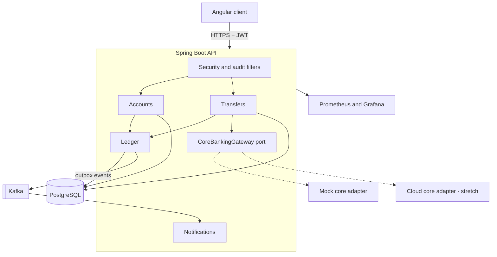
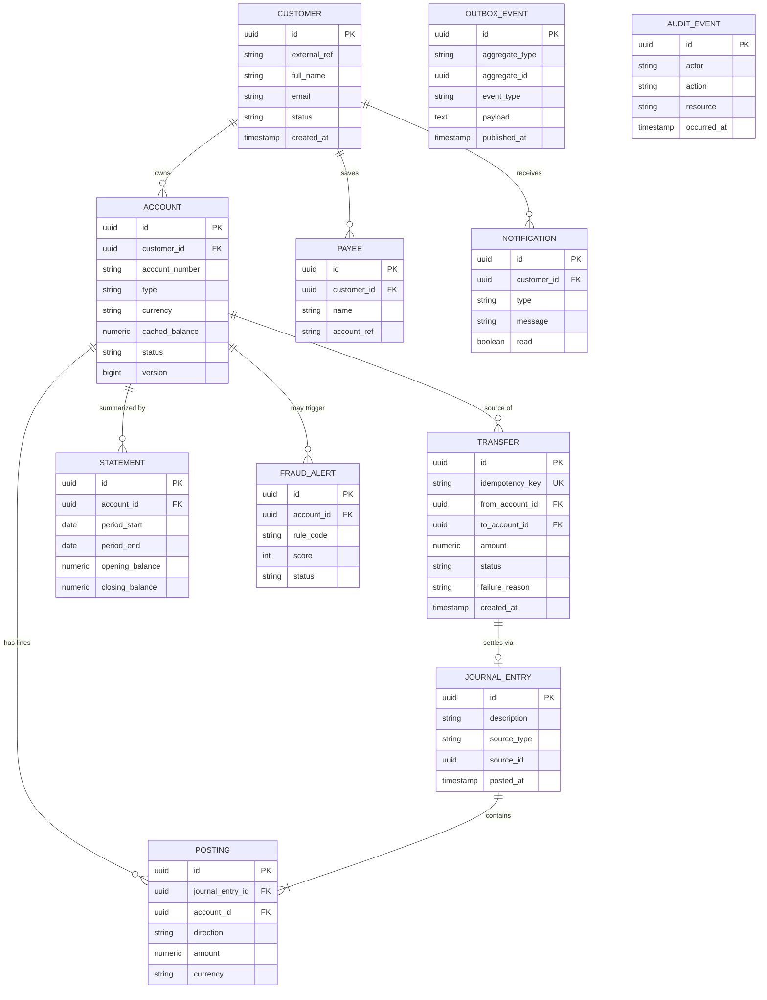

# Harbour Digital Banking Platform

A portfolio project: a modular, cloud-ready digital banking backend in **Java 21 / Spring Boot 3** with an **Angular** front end. It models the services a retail bank's digital channels depend on: accounts, a double-entry ledger, safe money transfers, event-driven notifications, and a swappable adapter in front of a core banking system.

> **Status:** Design phase. This document is the blueprint; see [`DEVELOPMENT_PLAN.md`](DEVELOPMENT_PLAN.md) for the week-by-week build.
>
> **Disclaimer:** Personal learning project. Fictional bank ("Harbour"), **synthetic data only**. No real customer data, no employer systems, no proprietary information.

---

## 1. Goals

| Goal | How the project demonstrates it |
|---|---|
| Modern Java fluency | Java 21 records, sealed types, streams, `Optional`, virtual threads, pattern matching |
| Enterprise Spring skills | Spring Boot 3, Spring Data JPA, Spring Security (OAuth2/JWT), Spring Kafka, Actuator |
| Banking domain depth | Double-entry ledger, idempotent transfers, interest accrual, statements, audit trail |
| Core banking migration story | `CoreBankingGateway` port with mock and "cloud core" adapters, so the core can be swapped without touching business logic |
| Engineering quality | Testcontainers, contract tests, CI/CD, observability, ADRs |
| Disciplined AI-assisted development | `docs/ai-workflow.md` records where AI helped, where it was wrong, and how output was verified |

### Non-goals
- Real payments, real money movement, or connections to real banks.
- Regulatory completeness (KYC/AML, PCI, OSFI rules). These are noted as "production considerations" only.
- Pixel-perfect UI. The front end exists to prove the API end to end.

---

## 2. Architecture

### 2.1 Style: modular monolith first

A **modular monolith** (one deployable, strict internal module boundaries) is the right start. It is simpler to build and test, and the module boundaries are the same seams you would use to split into microservices later. Modules communicate only through public interfaces and domain events, never by reaching into each other's tables or internals. This is enforced with **ArchUnit** tests.

### 2.2 System diagram



### 2.3 Key design decisions (to be recorded as ADRs in `docs/adr/`)

| # | Decision | Rationale |
|---|---|---|
| ADR-001 | Modular monolith with ArchUnit-enforced boundaries | Realistic, testable, and splittable later |
| ADR-002 | Money as `BigDecimal` wrapped in a `Money` record (amount + currency), minor-unit scale of 2 | Never use `double` for money |
| ADR-003 | Double-entry ledger; balances are derived from postings, with a cached balance column updated in the same transaction | Auditability; every dollar has a source and a destination |
| ADR-004 | Idempotency keys on all money-moving endpoints | Safe client retries; a core banking requirement |
| ADR-005 | Transactional outbox pattern for events | Avoids dual-write problems between DB and Kafka |
| ADR-006 | Optimistic locking (`@Version`) plus deterministic lock ordering on transfers | Prevents lost updates and deadlocks |
| ADR-007 | Hexagonal "port and adapter" for the core banking system | Core migration changes one adapter, not the domain |
| ADR-008 | JWT (OAuth2 resource server) with role- and ownership-based authorization | Standard bank API security model |
| ADR-009 | Flyway for schema migrations; no `ddl-auto` | Reproducible, reviewable schema history |
| ADR-010 | Testcontainers for all integration tests | Real PostgreSQL and Kafka, no mocks of infrastructure |

---

## 3. Domain model

### 3.1 Entity relationship diagram



### 3.2 Core domain types (initial Java sketch)

```java
// Value object. Never use double for money.
public record Money(BigDecimal amount, Currency currency) {
    public Money {
        Objects.requireNonNull(amount);
        Objects.requireNonNull(currency);
        amount = amount.setScale(2, RoundingMode.HALF_EVEN);
    }
    public static Money cad(String value) { return new Money(new BigDecimal(value), Currency.getInstance("CAD")); }
    public Money plus(Money other)  { requireSameCurrency(other); return new Money(amount.add(other.amount), currency); }
    public Money minus(Money other) { requireSameCurrency(other); return new Money(amount.subtract(other.amount), currency); }
    public boolean isNegative()     { return amount.signum() < 0; }
    private void requireSameCurrency(Money o) {
        if (!currency.equals(o.currency)) throw new CurrencyMismatchException(currency, o.currency);
    }
}

public enum AccountType { CHEQUING, SAVINGS, TFSA }
public enum AccountStatus { ACTIVE, FROZEN, CLOSED }
public enum Direction { DEBIT, CREDIT }
public enum TransferStatus { PENDING, COMPLETED, FAILED, REVERSED }

// Aggregate root
@Entity
public class Account {
    @Id private UUID id;
    @Version private long version;                 // optimistic locking
    private UUID customerId;
    private String accountNumber;
    @Enumerated(EnumType.STRING) private AccountType type;
    @Enumerated(EnumType.STRING) private AccountStatus status;
    private BigDecimal cachedBalance;
    private String currency;

    public void assertCanDebit(Money amount) {
        if (status != AccountStatus.ACTIVE) throw new AccountNotActiveException(id);
        if (balance().minus(amount).isNegative() && type != AccountType.CHEQUING)
            throw new InsufficientFundsException(id);
    }
}

// Ledger: a journal entry must balance (sum of debits equals sum of credits)
public record Posting(UUID accountId, Direction direction, Money amount) {}

public final class JournalEntry {
    private final UUID id;
    private final List<Posting> postings;

    public JournalEntry(List<Posting> postings) {
        if (postings.size() < 2) throw new IllegalArgumentException("Need at least two postings");
        if (!isBalanced(postings)) throw new UnbalancedJournalException();
        this.id = UUID.randomUUID();
        this.postings = List.copyOf(postings);
    }
    // isBalanced: group by currency and verify debits == credits
}

// Port to the core banking system (hexagonal architecture)
public interface CoreBankingGateway {
    CoreAccountSnapshot fetchAccount(String accountNumber);
    CoreTransferResult submitTransfer(CoreTransferRequest request);
    List<CoreTransaction> fetchTransactions(String accountNumber, LocalDate from, LocalDate to);
}
```

### 3.3 Business rules (each becomes a unit test)

1. Every journal entry balances: total debits equal total credits per currency.
2. Posted ledger entries are immutable. Corrections are reversing entries, never updates or deletes.
3. A transfer with a repeated idempotency key returns the original result and never posts twice.
4. Transfers lock accounts in a deterministic order (lowest UUID first) to avoid deadlocks.
5. Savings and TFSA accounts cannot go negative; chequing may have an optional overdraft limit.
6. A customer can only read and operate on their own accounts (ownership check on every request).
7. Frozen or closed accounts reject debits; closed accounts must have a zero balance.
8. Daily interest accrues on savings using actual/365 and is posted monthly as a journal entry.
9. Every state-changing request writes an immutable audit event.
10. Transfers above a configurable threshold, or matching fraud rules, create a `FraudAlert` and may be held.

---

## 4. Project structure

Single Maven (or Gradle) project with packages organized **by module first, then by layer**. Each module exposes only its `api` package to others.

```
harbour-bank-platform/
├── README.md                      <- this document
├── DEVELOPMENT_PLAN.md
├── docker-compose.yml             <- postgres, kafka, grafana, prometheus
├── pom.xml
├── .github/workflows/ci.yml
├── docs/
│   ├── adr/                       <- architecture decision records
│   ├── ai-workflow.md             <- how AI was used and verified
│   ├── api/openapi.yaml
│   └── diagrams/
├── src/main/java/dev/harbour/bank/
│   ├── HarbourBankApplication.java
│   ├── shared/                    <- Money, errors, ids, clock, outbox, audit
│   │   ├── money/
│   │   ├── error/                 <- ProblemDetail (RFC 7807) handlers
│   │   ├── outbox/
│   │   └── audit/
│   ├── security/                  <- JWT config, method security, ownership checks
│   ├── customers/
│   │   ├── api/                   <- public interfaces and DTOs for other modules
│   │   ├── domain/
│   │   ├── application/           <- services / use cases
│   │   ├── infra/                 <- JPA repositories
│   │   └── web/                   <- REST controllers
│   ├── accounts/                  <- same layout
│   ├── ledger/                    <- same layout (journal, postings, balances)
│   ├── transfers/                 <- same layout (idempotency, orchestration)
│   ├── notifications/             <- Kafka consumers, alert rules
│   ├── fraud/                     <- rules engine
│   ├── statements/                <- statement generation (PDF / CSV)
│   └── corebanking/
│       ├── CoreBankingGateway.java        <- port
│       ├── mock/MockCoreBankingAdapter.java
│       └── cloud/CloudCoreBankingAdapter.java   <- stretch
├── src/main/resources/
│   ├── application.yml
│   ├── application-local.yml
│   └── db/migration/              <- Flyway: V1__init.sql, V2__ledger.sql ...
├── src/test/java/dev/harbour/bank/
│   ├── architecture/              <- ArchUnit module-boundary tests
│   ├── ledger/ transfers/ ...     <- unit + slice tests per module
│   └── integration/               <- Testcontainers end-to-end tests
├── tools/
│   └── data-generator/            <- synthetic data CLI (Datafaker)
└── web/                           <- Angular client
    └── src/app/{auth,accounts,transfers,statements,shared}/
```

---

## 5. API outline (REST, versioned under `/api/v1`)

| Method | Path | Purpose | Notes |
|---|---|---|---|
| POST | `/auth/token` | Dev-only token endpoint | Or use a local Keycloak |
| GET | `/customers/me` | Current customer profile | |
| GET | `/accounts` | List my accounts | Ownership-filtered |
| GET | `/accounts/{id}` | Account detail and balance | 404 (not 403) if not owned |
| GET | `/accounts/{id}/transactions` | Paged, filterable history | `from`, `to`, `category`, `page`, `size` |
| POST | `/transfers` | Create a transfer | Requires `Idempotency-Key` header |
| GET | `/transfers/{id}` | Transfer status | |
| GET | `/accounts/{id}/statements` | List statements | |
| GET | `/accounts/{id}/statements/{period}` | Download PDF or CSV | |
| GET | `/notifications` | My notifications | |
| GET | `/payees` / POST `/payees` | Manage payees | |
| GET | `/admin/audit` | Audit log search | `ROLE_AUDITOR` only |

Errors use **RFC 7807 Problem Details** (`application/problem+json`). Documentation is generated with **springdoc-openapi**.

### Transfer flow (happy path)

1. Validate request, `Idempotency-Key`, and account ownership.
2. Return the stored result if the key was seen before.
3. Begin transaction: load both accounts in deterministic lock order.
4. Run fraud rules (may hold the transfer).
5. Build the balanced `JournalEntry` and persist postings; update cached balances.
6. Write `TransferCompleted` to the outbox in the same transaction; commit.
7. A relay publishes the outbox to Kafka; **Notifications** consumes it and creates alerts.

---

## 6. Security design

- OAuth2 resource server validating JWTs; roles `CUSTOMER`, `AUDITOR`, `ADMIN`.
- Ownership enforced in the service layer (not only the controller), via `@PreAuthorize` and a reusable `OwnershipGuard`.
- Input validation with Bean Validation; strict DTOs (no entity exposure).
- Rate limiting on auth and transfer endpoints (Bucket4j).
- Secrets via environment variables / Azure Key Vault; none in the repo.
- Dependency and image scanning in CI (OWASP Dependency-Check or Trivy); secret scanning on the repo.
- PII masking in logs; correlation IDs on every request.
- Threat model summary in `docs/security.md` (STRIDE-lite).

---

## 7. Testing strategy

| Layer | Tooling | Target |
|---|---|---|
| Unit | JUnit 5, AssertJ, Mockito | Domain rules (Money, ledger balancing, interest) with 90%+ coverage in `domain` |
| Property-based | jqwik | "Any sequence of transfers keeps the sum of all balances constant" |
| Slice | `@DataJpaTest`, `@WebMvcTest` | Repositories and controllers |
| Integration | Testcontainers (PostgreSQL, Kafka) | Full transfer flow, outbox relay, idempotency under concurrency |
| Architecture | ArchUnit | No cross-module internals access; no cycles |
| Contract | Spring Cloud Contract or Pact | Angular/API contract |
| Load | k6 | Concurrent transfers; verify no lost updates or deadlocks |

**Concurrency test to showcase:** fire 200 parallel transfers across a small set of accounts, then assert that total money is conserved and no balance is negative.

---

## 8. Observability and operations

- Spring Boot Actuator, Micrometer metrics, Prometheus scrape, Grafana dashboards (transfer rate, p95 latency, failure rate, outbox lag).
- Structured JSON logging with correlation IDs; OpenTelemetry tracing (stretch).
- Docker multi-stage build; `docker compose up` starts everything locally.
- GitHub Actions: build, test, scan, build image, deploy to Azure Container Apps (or AKS).

---

## 9. Synthetic data strategy

Short answer: **it can be generated, and the generator is itself a portfolio asset.** Do not use real customer or employer data.

**Approach:** a `tools/data-generator` module using **[Datafaker](https://www.datafaker.net/)** (Java library, supports Canadian locales such as `en-CA`) with a fixed random seed so datasets are reproducible.

| Data | Generation approach |
|---|---|
| Customers (names, addresses, emails) | Datafaker `en-CA`; emails on `@example.com`; phones in the reserved `555-01xx` range |
| Accounts | 1 to 3 per customer; mix of chequing, savings, TFSA; account numbers from a documented fake scheme |
| Transactions | Weighted categories (groceries, rent, transit, dining, utilities, payroll); a payroll deposit every two weeks; realistic amounts with monthly seasonality |
| Merchants | A hand-curated list of **fictional** merchant names per category |
| Transfers and payees | Random but valid peer transfers between synthetic customers |
| Fraud cases | Inject known patterns (rapid velocity, unusual amount, new payee plus large transfer) with labels for rule testing |
| Scale | Profiles: `small` (50 customers), `demo` (1,000), `load` (100,000) |

**Rules for the repo:**
- Never generate realistic SINs, real card numbers (Luhn-valid test numbers only if truly needed), or real addresses.
- Seed data loads through the same service layer as production code (`--spring.profiles.active=seed`), so it also exercises the business rules.

**External options (optional):**
- **Mockaroo** for quick CSV/JSON fixtures.
- **Kaggle** public datasets such as the PaySim synthetic mobile-money fraud dataset, useful for tuning fraud rules. Check each dataset's license before redistributing, and prefer referencing it over committing it.

---

## 10. Stretch features

1. **AI insights:** spending summary or "explain this transaction" via the Claude API, with PII masked before leaving the service and prompts/outputs logged for review.
2. **Cloud core adapter:** a second `CoreBankingGateway` implementation against a REST-style core (OpenAPI-generated client) to demonstrate the migration story.
3. **Statement PDFs** with a templating library.
4. **Resilience:** Resilience4j circuit breaker, retry, and bulkhead around the core adapter.
5. **GraphQL** read API for the front end.
6. **Multi-currency** accounts with FX posting entries.

---

## 11. Definition of done (project level)

- [ ] `docker compose up` brings up a working system with seeded demo data
- [ ] All business rules in section 3.3 covered by tests
- [ ] Concurrency test proves money conservation
- [ ] CI is green with scans; coverage badge visible
- [ ] OpenAPI docs published; Angular demo works end to end
- [ ] ADRs, security notes, and `ai-workflow.md` written
- [ ] README includes screenshots, architecture diagram, and a 3-minute demo GIF or video
